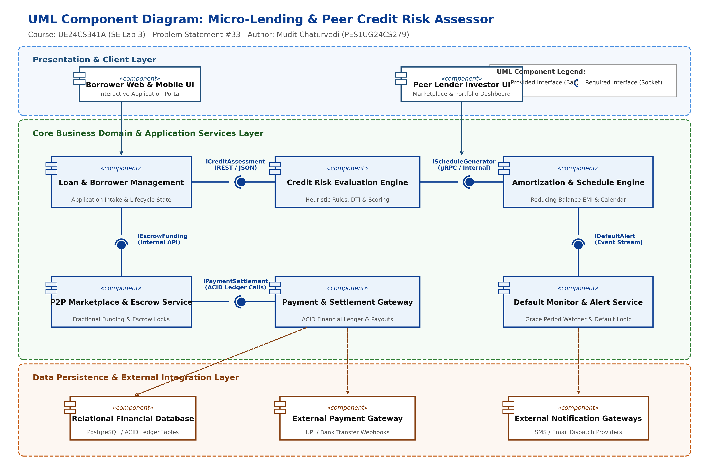

# Micro-Lending & Peer Credit Risk Assessor
### Individual Software Engineering Project — Problem Statement #33
**Domain:** Retail, E-Commerce & Finance  
**Institution:** Department of Computer Science & Engineering, PES University  
**Course:** Software Engineering (UE24CS341A)  

| Student Details | Submission Metadata |
| :--- | :--- |
| **Name:** Mudit Chaturvedi | **SRN:** PES1UG24CS279 |
| **Section:** 5E | **Jira Site:** `mudit300477.atlassian.net` |
| **Repository:** `MyProject_MicroLending` | **Term:** Fall Semester 2026 |

---

## 1. Problem Context & Overview
The **Micro-Lending & Peer Credit Risk Assessor** is an end-to-end peer-to-peer (P2P) micro-finance platform engineered to provide fair, transparent, and algorithmic credit access to micro-borrowers while enabling retail peer lenders to diversify capital across risk-vetted loan portfolios.

The system addresses the limitations of legacy banking credit systems through four core capabilities:
1. **Algorithmic Credit Risk Underwriting:** Evaluating creditworthiness using deterministic heuristic scoring rules based on Debt-to-Income (DTI) ratio, employment stability, and verified repayment history (`FR-001`).
2. **Reducing Balance Amortization:** Generating exact monthly Equated Monthly Installment (EMI) schedules with mathematical precision (`FR-002`).
3. **Escrow-Backed Peer Funding:** Facilitating fractional lender commitments with atomic overfunding prevention and regulatory escrow balance locks (`FR-003`).
4. **Automated Repayment & Default Monitoring:** Processing ACID installment distributions to participating lenders and triggering automated, tiered default escalations upon missed deadlines (`FR-004`, `FR-005`).

---

## 2. Repository Structure & Deliverables Index

In accordance with the PES University individual project submission guidelines, all project artifacts are organized into structured directories:

```
MyProject_MicroLending/
├── 1-Requirements_Engineering/
│   ├── Requirements_Specification.md         # Exactly 5 FRs, 2 NFRs & RTM Table
│   ├── Use_Case_Flow_Specification.md        # 1-page spec for core use case (UC-01)
│   ├── UML_Use_Case_Diagram.drawio           # Editable draw.io source diagram
│   ├── UML_Use_Case_Diagram.jpg              # High-res rendered Use Case Diagram
│   └── Requirements_Engineering_Report.pdf   # Compiled PDF submission
├── 2-Architectural_Diagram/
│   ├── Architectural_Justification.md        # 1-page architectural selection doc
│   ├── Component_Diagram.drawio              # 6 components, 5 interfaces (ball & socket)
│   ├── Component_Diagram.png                 # High-resolution rendered Component Diagram
│   └── Architectural_Justification_Report.pdf# Compiled PDF submission
├── 3-Project_Creational_Screenshots/
│   ├── README.md                             # Jira project setup & agile workflow notes
│   ├── 01_kanban_board_epics_fr.png          # Kanban board with FR Epics
│   ├── 02_kanban_board_more_epics.png        # Swimlane Epic mapping
│   ├── 03_kanban_list_epics_backlog.png      # Product Backlog view
│   ├── 04_scrum_backlog_sprint2_points.png   # Sprint 2 planning & story points
│   ├── 05_scrum_active_sprint_done.png       # Active Sprint board at completion
│   ├── 06_scrum_burndown_sprint2.png         # Sprint 2 Burndown velocity chart
│   ├── 07_scrum_burndown_sprint1.png         # Sprint 1 Burndown chart
│   ├── 08_bug_board_all_bugs.png             # QA Defect board
│   ├── Kanban.PDF & Scrum.PDF                # Jira module export PDFs
│   └── Mudit Chaturvedi_PES1UG24CS279-BPS#33.pdf # PES portal Jira report
├── 4-SRS_and_Work_Breakdown/
│   ├── SRS_Micro_Lending_PES1UG24CS279.md    # IEEE 830-1998 standard SRS
│   ├── Work_Breakdown_Structure.md           # 5-phase WBS & effort estimation table
│   └── SRS_Document_PES1UG24CS279.pdf        # Compiled PDF submission
├── 5-Github_Copilot_Generated_Code/
│   ├── credit_risk_assessor.py               # FR-001 Credit Risk Engine
│   ├── amortization_schedule.py              # FR-002 Reducing Balance EMI Engine
│   ├── escrow_marketplace.py                 # FR-003 P2P Escrow Funding Manager
│   ├── default_monitor.py                    # FR-005 Automated Default Warning Engine
│   ├── main.py                               # Complete runnable end-to-end demo
│   └── Copilot_Usage_Log.md                  # Copilot prompt engineering & session logs
├── 6-Software_Testing_Tools/
│   ├── test_micro_lending.py                 # Automated test suite (8 test cases, Pytest)
│   └── Software_Testing_Report.md            # Test matrix & vibe coding patch analysis
└── README.md                                 # Master repository documentation
```

---

## 3. Requirements Summary

### Functional Requirements (FR-001 to FR-005)
- **FR-001 (High):** System shall compute credit risk ratings (`Low`, `Medium`, `High`) and scores (300–850) based on DTI, repayment ratio, and employment tenure.
- **FR-002 (High):** System shall generate reducing-balance EMI schedules with exact principal reconciliation.
- **FR-003 (High):** System shall allow authenticated peer lenders to fund fractional amounts and lock funds in escrow without overfunding.
- **FR-004 (Medium):** System shall process repayments and disburse proportional dividends to lenders inside ACID transactions.
- **FR-005 (High):** System shall monitor due dates and trigger tiered default warnings ($T+3$ grace period reminder, $T+15$ formal default).

### Non-Functional Requirements (NFR-001 & NFR-002)
- **NFR-001 (Performance & Security):** Repayments and escrow distribution must execute in serializable ACID transactions with $99\text{th}$ percentile latency $< 350\text{ ms}$.
- **NFR-002 (Reliability & Data Privacy):** Borrower PII and financial records must be encrypted at rest (AES-256) and in transit (TLS 1.3), with daily backups ensuring $\text{RPO} \le 15\text{ mins}$ and $\text{RTO} \le 1\text{ hr}$.

---

## 4. Architecture & Component Design
The system employs a **3-Tier Layered Architecture** with decoupled domain components communicating via explicit UML ball-and-socket interfaces:



1. **Loan & Borrower Management Component:** Manages borrower KYC, intake, and lifecycle states.
2. **Credit Risk Evaluation Engine:** Evaluates heuristic rules and score vectors via provided interface `ICreditAssessment`.
3. **Amortization & Schedule Engine:** Computes reducing-balance EMI tables via provided interface `IScheduleGenerator`.
4. **P2P Marketplace & Escrow Service:** Manages fractional commitments and wallet locks via provided interface `IEscrowFunding`.
5. **Payment Gateway & Settlement Service:** Coordinates with external banking gateways and maintains transactional ACID ledgers via `IPaymentSettlement`.
6. **Default Monitor & Alert Service:** Dispatches automated grace reminders and default notices via `IDefaultAlert`.

---

## 5. Quick-Start Guide (Running Code & Tests)

### Prerequisites
- Python 3.10 or higher
- `pytest` (for test suite)
- `reportlab` & `matplotlib` (for document and diagram compilation)

```bash
# Clone the repository
git clone https://github.com/InterstellarMC/MyProject_MicroLending.git
cd MyProject_MicroLending
```

### Running the End-to-End Platform Demo
```bash
python3 5-Github_Copilot_Generated_Code/main.py
```

### Running the Automated Test Suite
```bash
cd 6-Software_Testing_Tools
pytest -v test_micro_lending.py
```
*Expected Result: 8 passed in ~0.04s.*

---

## 6. Academic Integrity & Verification
This repository and all associated deliverables represent original academic coursework completed for **UE24CS341A: Software Engineering** at PES University. All diagrams adhere to UML 2.5 standards, requirements follow IEEE Std 830-1998 guidelines, and agile workflows reflect authentic project management on Atlassian Jira Cloud.
